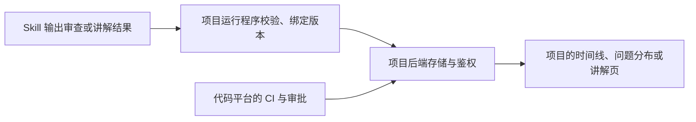

# Code Review Skill

一个可在多个代码库中使用的 Codex Skill。它能在 PR 上分派独立子 Agent 找缺陷、复核证据并追踪修复，也可以回答团队关于某段代码为何这样工作的问题。流程参考 [Claude Code 团队的代码审查实践](https://claude.dev/blog/solving-code-review-at-anthropic/)。

## 安装和使用

在 Codex 中输入以下请求，将 v0.1.0 安装为用户级 Skill，供本机多个项目调用。

```text
$skill-installer 从 https://github.com/zero7710/code-review-skill/tree/v0.1.0/skills/code-review 安装 code-review
```

在要审查的项目中打开一个新对话，选择「代码审查与讲解」或直接输入以下请求。

```text
$code-review 审查当前分支相对 main 的改动，列出有源码证据的发现。
$code-review 解释这个项目中一次文件导入如何从请求入口走到数据写入，附对应源码位置。
```

目标项目可以在自己的 `REVIEW.md` 里维护业务约束、关键检查和合并条件。团队需要复现某次评测或 CI 审查时，固定 Skill 的提交 SHA，并记录当次模型、工具及项目规则版本。

## 接入项目后台

调用时要求「仅返回符合结果契约的 JSON」。审查结果包含轮次、证据、意见和处置，代码讲解包含源码版本、节点和关系。项目的运行程序校验结果，补上仓库、提交和运行编号，再写入自己的存储。管理员页面从该项目的后端读取历史，CI 和审批状态取自代码平台。



在对话里讲解一段代码时，Skill 也能按需直接画调用图。跨 PR 的问题统计、跨轮次的历史回放由接入方持久化后呈现。

例如，已发布意见 `F-17` 在下一轮通过修复验证时，运行程序用同一编号追加 `verified_fixed`。时间线多一条验证记录，项目缺陷总数保持一个。具体字段和两个可校验示例见[结果契约](skills/code-review/references/outputs.md)。

在 [Skill 目录](skills/code-review/) 下运行以下命令可校验输出或比较已判分的评测记录。结果校验需要 Python 的 `jsonschema` 4.x（`python -m pip install "jsonschema>=4,<5"`），离线计分只用 Python 标准库。

```sh
python scripts/validate_result.py result.json
python scripts/score_eval.py baseline.json candidate.json
```

审查中的复核与停止条件见[审查流程](skills/code-review/references/review.md)，构造历史案例与盲测计分的方法见[评测说明](skills/code-review/references/evaluation.md)。
